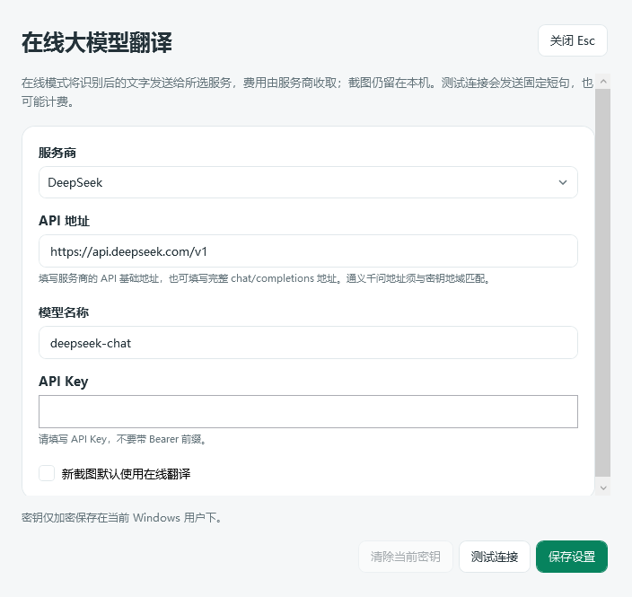

# 2.0.11 DeepSeek 与通义千问在线翻译

用户确认接入 DeepSeek、通义千问。保留本地 OCR、离线翻译、编辑性能、系统分享与窗口恢复；在线模式仅发送 OCR 后的文字。密钥由用户在软件设置内填写。

## 修改文件

- `src/Snip.Core/OnlineTranslationSettings.cs`：设置/凭据与存储接口；凭据 ToString 脱敏，禁止进入日志。
- `src/Snip.Infrastructure/OnlineTranslationSettingsStore.cs`、`Snip.Infrastructure.csproj`：Windows 当前用户 DPAPI，独立提供方配置、原子写入、密钥清除与地址变更保护。设置与密钥文件不属于诊断导出目录。
- `src/Snip.Translation/OnlineTranslator.cs`：提供方默认地址/模型及非流式聊天补全，Bearer 认证、只发送文本、60 秒截止、取消、大小限制、禁止自动重定向、鉴权/限流/格式/网络错误的固定提示；不回显服务错误正文。通义千问非流式调用禁用思考模式。
- `src/Snip.App/ViewModels/OnlineTranslationSettingsViewModel.cs`、`Views/OnlineTranslationSettingsWindow.xaml`、`.xaml.cs`：服务切换、地址、模型、掩码密钥、默认模式、保存、清除、主动测试连接、关闭取消。保存或切换后清除密码框显示。
- `src/Snip.App/ViewModels/TextResultViewModel.cs`、`Views/TextResultWindow.xaml`：离线/在线切换、明确的文字发送提示、在线设置入口、失败保留、在线流程绕过离线模型。较小窗口仍保留正文滚动。
- `src/Snip.App/Services/FeatureHub.cs`、`App.xaml.cs`、`ViewModels/MainViewModel.cs`、`Views/MainWindow.xaml`、`Views/EditorToolbar.cs`：统一服务组合与主窗口入口；翻译工具描述同时覆盖在线与离线。损坏的可选设置不阻止打开 OCR。
- `tests/Snip.Translation.Checks/OnlineTranslationChecks.cs`、`Program.cs`：确定性的 HTTP 协议、两服务请求、错误正文脱敏、空/非法响应、取消、网络错误回归，不联网、不使用真实密钥。
- `tests/Snip.Windows.Checks/OnlineSettingsChecks.cs`、`Program.cs`、`TextWindowChecks.cs`、`UiGalleryCheck.cs`：实际 DPAPI、两个密钥独立保存、密码框清除、真实设置 XAML、在线结果绕过离线模型与失败保留。
- `packaging/Validate.ps1`、`Directory.Build.props`、`docs/使用说明.md`：新增必跑检查、版本与使用说明。

## 验证与边界

本地与 CI 无警告编译，70 项 Core 和 14 个确定性在线协议检查通过。[Windows CI 38542085261](https://github.com/shouhuqingtian/snip/actions/runs/38542085261) 全部 13 组桌面检查 Passed，无 Failed/Unrun；包含实际 DPAPI、设置 XAML、在线路由、编辑性能、系统分享、窗口定位/关闭、剪贴板、13 个窗口预览、真实离线模型、Chrome、原生 OCR 和 OCR→离线翻译 UI。实际单文件 EXE 的诊断导出也通过。

Windows 密钥检查实际解密 DPAPI 数据核对原值、确认 JSON 中没有明文密钥；验证重启读取、两个提供方独立保存、地址更换不复用旧密钥、密码框清空和删除。结果窗口检查在没有离线模型的场景使用可控在线服务返回译文，确认离线服务调用数为零，服务失败时保留原文和此前译文。

测试源码提交 `07ad895a8019892d48f1df2c118fd461461f0d69`，发行 `build-info.json` 为 2.0.11-preview、SourceDirty=false。重新下载并核对便携、完整源码、UI 预览 SHA256。

[下载 2.0.11 便携版](https://github.com/shouhuqingtian/snip/releases/download/preview-07ad895a8019/self-snip-preview-win-x64.zip) · [完整源码](https://github.com/shouhuqingtian/snip/releases/download/preview-07ad895a8019/self-snip-source.zip)。退出旧版托盘后解压运行 Snip.exe，已有本地模型兼容。

测试只使用公开的模拟密钥和响应，不调用收费服务，不能将模拟协议检查写成已通过用户账号的实际 DeepSeek/通义千问服务验收。官方文档网页在本云环境网络代理被拒绝访问，未绕过代理或 TLS 校验；默认地址/模型支持手动修改，并采用聊天补全协议验证。

默认离线，不会因填写密钥自动上传截图或文字。设置中明确选择在线默认后，用户的新截图翻译入口可自动发送识别文字；主动测试连接发送固定短句并可能计费。在线结果质量由模型决定，OCR 错误仍应先修正。
