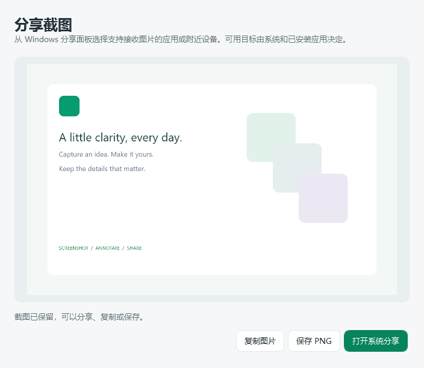

# 2.0.8 Windows 系统分享与羊图标

将不可用的微信窗口自动操作替换为 Windows 原生分享。点击截图或编辑工具栏的分享箭头，打开独立截图预览并调用系统分享面板；接收应用或附近设备由 Windows 提供。截图不会由本软件直接发送给联系人。

## 修改文件

- `src/Snip.Infrastructure/WindowsShareSession.cs`：通过桌面 HWND 绑定 DataTransferManager；后台编码 PNG，系统 DataRequested 同时提供只读文件、Bitmap 和缩略图。系统不支持、准备失败和关闭取消均有处理。分享数据文件允许接收端异步读取，下一次分享清理超过 24 小时的临时图片。日志不包含图片或路径。
- `src/Snip.App/Views/WindowsShareWindow.cs`：独立截图预览、自动打开系统分享、重试、复制、保存 PNG；失败保留窗口，取消准备后不打开迟到面板。
- `src/Snip.App/Services/FeatureHub.cs`、`SelectionSession.cs`、`src/Snip.App/Views/EditorToolbar.cs`、`SelectionWindow.cs`：选区和独立编辑器入口统一改为 Windows 系统分享，移除微信联系人的自动操作流程。
- 删除 `src/Snip.App/Views/WeChatShareWindow.cs`、`WeChatDiagnosticsWindow.cs`、`src/Snip.Infrastructure/WeChatAutomation.cs`、`WeChatDiagnostics.cs`；`src/Snip.App/App.xaml.cs` 移除旧诊断启动入口。
- `src/Snip.Infrastructure/Assets/sheep.ico`、`sheep.png`：原创绿色底、白色羊图标，ICO 包含 16、20、24、32、40、48、64、128、256 多尺寸。
- `src/Snip.Infrastructure/TrayService.cs`、`Snip.Infrastructure.csproj`：托盘使用内嵌羊图标，释放 NotifyIcon 后释放图标句柄，保留所有菜单。
- `src/Snip.App/Snip.App.csproj`、`Styles/Theme.xaml`：EXE 原生图标与所有窗口图标使用同一资源，单文件发行不依赖额外外部 ICO。
- `tests/Snip.Windows.Checks/WindowsShareChecks.cs`、`Program.cs`、`UiGalleryCheck.cs`、`packaging/Validate.ps1`：真实 WPF 入口、分享失败/取消、托盘资源、真实 WinRT 图片/文件数据及系统面板验证。验证不会选择分享目标或发送图片。
- `Directory.Build.props`、`docs/使用说明.md`：版本及系统分享操作说明。

## 验证状态

Linux 与 Windows 均无警告编译，56 项 Core 全通过。[Windows CI 38526121175](https://github.com/shouhuqingtian/snip/actions/runs/38526121175) 的全部 11 组检查均为 Passed，无 Failed/Unrun：Windows 基础、编辑性能、分享 UI、原生分享、文字 UI、剪贴板、12 个实际窗口预览、真实离线翻译、Chrome、OCR、OCR→翻译 UI。实际打包单文件 EXE 的诊断导出也通过。

分享 UI 回归验证实际选区工具栏跳转、原图传递、重试复用、失败保留、关闭取消与迟到结果抑制；真实 NotifyIcon 可见并装载羊图标、保留菜单。原生检查实际构建 WinRT DataPackage，读取 PNG 文件及 Bitmap 流、核对 80×60 尺寸，然后调用桌面 HWND 的系统分享面板，并收到系统 DataRequested 请求。没有选择或点击任何分享目标，没有发送图片。

重新下载并核对便携、完整源码和 UI 预览的 SHA256；`build-info.json` 为 2.0.8-preview，源码提交 `92c21e5b9cc095dd3e975b4d1eef88fccfdd3f5d`，SourceDirty=false。解析发布 EXE 的 PE 图标资源，核对其包含原 ICO 的全部 9 个羊图标尺寸。

[下载便携版](https://github.com/shouhuqingtian/snip/releases/download/preview-92c21e5b9cc0/self-snip-preview-win-x64.zip) · [完整源码](https://github.com/shouhuqingtian/snip/releases/download/preview-92c21e5b9cc0/self-snip-source.zip) · [12 个界面预览](https://github.com/shouhuqingtian/snip/releases/download/preview-92c21e5b9cc0/ui-previews.zip)。退出托盘中的旧版后，解压运行 Snip.exe；已有翻译模型继续使用。

## 使用边界

系统只显示已注册的分享目标，不能保证所有聊天软件都在列表中；不再依赖微信版本。用户需要在系统或接收应用中选择目标并完成发送。当前版本的离线 OCR、翻译、长截图及 2.0.7 编辑性能优化保留。
